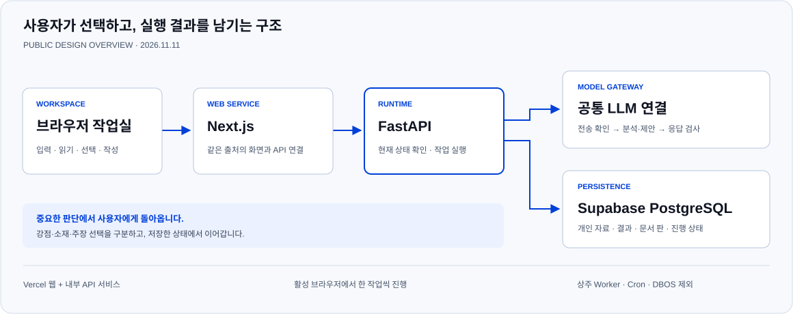
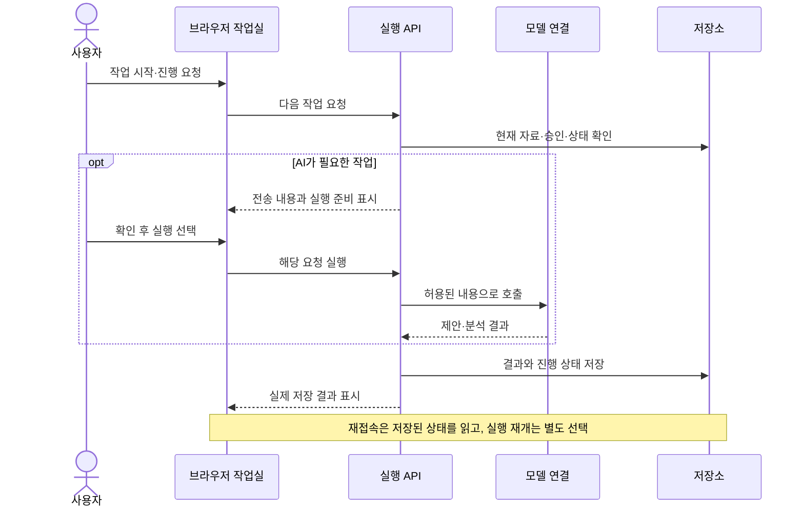

# 시스템 설계

[← 프로젝트 소개](README.md) · [사용자 흐름](USER_JOURNEY.md) · [현재 상태](STATUS.md)

## 하나의 작업실, 이어지는 준비 과정

이 프로젝트의 중심은 사용자가 시작한 **지원 준비 작업**입니다. 회사 조사나 경험 분석은 이 작업 안의 절차이며, 각 절차가 독립된 제품이나 별도 실행 시스템이 되지 않도록 기존 실행 구조를 재사용합니다.

| 구성 | 맡는 일 | 이렇게 나눈 이유 |
|---|---|---|
| **브라우저 작업실** | 공고·자료 입력, 결과 읽기, 사용자 선택, 직접 작성 | 사용자가 준비 과정을 이해하고 필요한 지점에서 방향을 바꿀 수 있어야 합니다. |
| **웹 연결 계층** | 같은 서비스 안에서 화면과 API를 연결 | 개인 공간과 서버 연결 정보를 브라우저의 공개 정보와 구분합니다. |
| **실행 API** | 다음 작업 실행, 현재 입력과 승인 확인, 결과 저장 | 화면이 바뀌어도 실행과 승인 규칙을 일관되게 적용합니다. |
| **공통 모델 연결** | 필요한 맥락 구성, 전송 확인, 모델 호출, 응답 검사 | 조사·분석·작성 제안이 같은 전송·사용량 원칙을 따르게 합니다. |
| **영속 저장소** | 자료, 결과, 문서의 판, 진행 상태와 선택 기록 | 재접속 후에도 실제 저장된 상태를 기준으로 작업을 복원합니다. |

기술 구성은 **Next.js + FastAPI / Vercel + Supabase PostgreSQL**입니다. 현재 공개 체험은 브라우저별 개인 공간을 사용합니다. 계정 로그인과 기기 간 복원은 별도 범위입니다.

## 실행은 작게, 상태는 오래 남기기

브라우저가 활성인 동안 한 번에 한 작업을 진행합니다. 중요한 선택이나 보완할 입력이 있으면 사용자에게 돌아옵니다. 상주 Worker, 정기 Cron, DBOS에 의존하지 않습니다. 이미 전송된 요청은 탭이 닫힌 뒤에도 완료될 수 있으므로, 다시 열었을 때 실제 저장 여부를 확인합니다.

## 사실, 제안, 승인을 구분하기

**자료와 경험**은 글의 재료입니다. **모델의 분석과 문장**은 그 재료를 해석한 제안입니다. **사용자의 선택**은 특정 방향으로 진행하겠다는 결정입니다. 이 셋을 같은 것으로 취급하지 않는 것이 핵심입니다.

예를 들어 사용자가 특정 주장을 선택했다고 해서 부족했던 사실 근거가 새로 생기지는 않습니다. 문장을 생성했다고 해서 문서가 승인되거나 제출된 것도 아닙니다. 보여줄 강점, 소재, 핵심 주장, 문서 확정은 각각 검토할 수 있도록 구분합니다.

## 맥락을 이어 주는 방식

회사가 실제로 하는 일과 직무의 산출물을 이해하고, 그 요구에 맞는 경험과 근거를 대조합니다. 이어서 어떤 장면에서 어떤 판단을 했고, 행동과 결과가 어떻게 연결됐는지를 문항의 주장으로 정리합니다. 다음 작업은 저장된 결과와 사용자가 선택한 자료를 바탕으로 이어갑니다.

독자가 문장에서 무엇을 추론할지, 작성 의도 없이 읽으면 어떤 사람으로 보일지도 검토 대상으로 둡니다. 문제가 있으면 전체 내용을 다시 만드는 것보다 문제가 생긴 지점과 관련된 범위를 고치는 방향을 지향합니다. 이 검토의 전체 자동 연결과 실제 품질 인수는 계속 남아 있습니다.

## 유지하는 경계

- 개인 자료와 결과는 사용자 공간별로 분리합니다.
- 화면을 다시 열거나 상태를 조회하는 동작만으로 AI를 호출하지 않습니다.
- 비용과 전송 범위를 확인한 요청만 실행하는 기존 원칙을 유지합니다.
- 자기소개서와 레쥬메는 독립적인 작성 경로로 둡니다.
- 이 문서는 설계 요약입니다. 프롬프트·내부 계약·DB 정의·실행 코드는 포함하지 않습니다.
