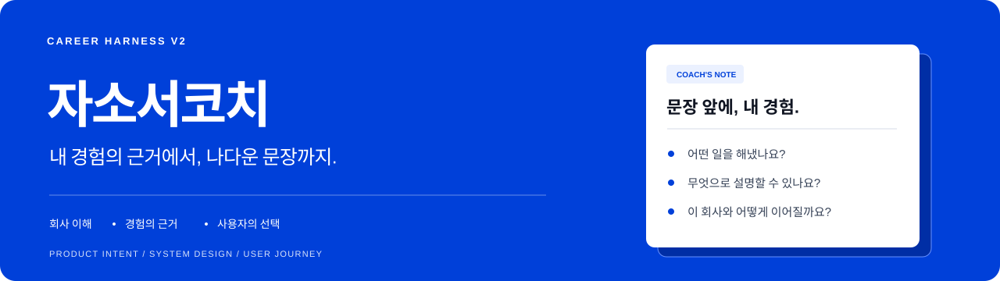
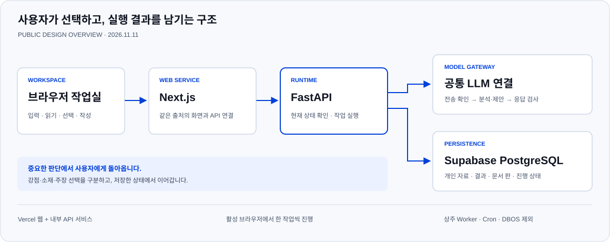

  

  <a href="https://jasoseo-coach-v2.vercel.app"><strong>자소서코치 체험하기 ↗</strong></a>
  &nbsp; · &nbsp;
  <a href="#workflow">사용 흐름</a>
  &nbsp; · &nbsp;
  <a href="#design-examples">문제 → 적용 예시</a>
  &nbsp; · &nbsp;
  <a href="#design-difference">설계의 차이</a>
  &nbsp; · &nbsp;
  <a href="#current-scope">현재 상태</a>

## 좋은 문장보다 먼저, 내 경험을 이해하는 일

**자소서코치**는 회사와 직무를 이해하고, 내 경험에서 근거를 찾고, 왜 이 문항에 이 이야기를 쓰는지 정리하는 작업실입니다. AI는 분석과 방향을 제안하고, 사용자는 자신이 설명할 수 있는 강점·소재·주장을 선택합니다.

자기소개서를 준비하며 어려웠던 일은 표현을 매끄럽게 바꾸는 것만이 아니었습니다. 공고에 익숙한 단어가 보인다는 이유로 직무를 잘못 이해하기도 하고, 문장을 다듬는 동안 팀의 성과가 개인의 성과처럼 바뀌기도 합니다. 지원동기를 쓰고 나면 어느 회사에나 들어갈 수 있는 설명만 남는 경우도 있습니다.

이런 문제는 글을 잘 쓰는 능력과 별개로 생깁니다. 회사가 실제로 요구하는 일, 내가 한 일의 범위, 문항에서 전달할 판단이 먼저 정리돼 있어야 하기 때문입니다. 자소서코치는 **공고를 이해하는 일부터 경험을 고르고 문항의 요점을 정하는 일까지, 글이 만들어지기 전의 판단을 제품 안에 남기려는 시도**입니다.

## 함께 준비하는 순서

회사 조사에서 필요한 경험을 좁히고, 경험 대조에서 말할 수 있는 범위를 확인한 뒤, 문항마다 어떤 판단을 보여줄지 정합니다. 한 단계에서 한 선택이 다음 단계의 승인을 대신하지는 않습니다.

공식 문항이 있다면 직접 등록해 시작할 수 있습니다. 경험은 갖고 있는 파일에서 가져오되, 자료를 읽는 일과 그 내용을 사실로 확정하는 일은 구분합니다. 각 작업 화면에는 지금 이 작업을 하는 이유와 다음에 확인할 내용을 짧게 안내합니다.

## 예시로 보는 설계 의도

**아래는 모두 설계 설명용 가상 사례입니다. 실제 사용자의 경험, 유료 모델의 생성 결과, 타 서비스의 측정 결과가 아닙니다.** ‘적용 후’는 이 설계로 남기려는 판단과 표현을 보여줍니다. 아직 전체 연결·품질 검증이 끝나지 않은 검토 기능도 함께 설명하며, 실제 범위는 맨 아래에 구분했습니다.

여러 예시에서 같은 원문을 사용합니다.

> **가상 경험 원문** 
> 팀이 운영 데이터를 분석한 프로젝트에서, 본인은 자료 정리와 월별 집계 검증을 맡았습니다. 두 자료의 날짜 기준이 달라 월별 건수가 맞지 않음을 확인했습니다. 같은 기준일로 다시 집계하고 원문 기록과 수정 표를 대조했습니다. 모델 개발은 다른 팀원이 담당했습니다. 운영 효율이나 모델 성능이 얼마나 개선됐는지는 측정하지 않았습니다.

이 원문에 없는 성과나 역할을 추가하지 않고, 회사 이해부터 문항 선택·검토·수정까지 어떻게 달라져야 하는지 살펴봅니다.

## 1. 회사 분석을 깊게 하는 이유

“혁신적인 회사”, “데이터를 중요하게 생각하는 직무” 같은 표현만으로는 지원자가 어떤 경험을 꺼내야 하는지 알기 어렵습니다. 같은 ‘분석’ 직무여도 고객의 요구를 정리하는 일, 운영 이상을 찾는 일, 실험을 설계하는 일은 필요한 판단과 결과물이 다릅니다.

그래서 회사의 본업과 고객, 실제 업무 방식, 직무가 만들어야 할 산출물까지 내려가서 이해하려 합니다. 분석 결과는 회사 소개에서 끝나지 않고 **“이 일을 한다면 어떤 경험과 근거를 보여줘야 할까?”**라는 다음 질문으로 이어져야 합니다.

가령 직무가 요구하는 결과물이 ‘운영 문제를 설명하고 다음 조치를 제안하는 보고서’라면, 사용자의 경험에서도 단순히 분석 도구를 써본 사실보다 문제를 어떻게 좁혔고 어떤 선택을 제안했는지를 살펴야 합니다. 이 예시는 설계 의도를 설명하기 위한 가상 상황입니다.

**❌ 문제가 되는 예시**

> “데이터를 중요하게 생각하는 회사라서, Python을 사용한 제 경험과 잘 맞습니다.”

회사와 직무에 실제로 필요한 일이 무엇인지 설명되지 않습니다.

**→ 이 설계를 적용하면**

가상 공고의 업무가 ‘서로 다른 운영 자료를 대조해 정기 보고서를 만드는 일’이라고 가정합니다. 코치는 도구 이름보다 집계 기준을 맞추고 수치를 확인하는 일이 왜 필요한지 정리합니다. 사용자는 아래 가상 경험 중 날짜 기준을 대조한 일을 이 요구와 연결할지 선택합니다.

**✅ 남기려는 결과**

> “운영 자료의 비교 기준을 확인해야 하는 업무와, 두 자료의 날짜 기준 차이를 찾아 집계 조건을 맞춘 경험을 연결합니다.”

회사명과 키워드를 바꾼 소개 대신 **직무의 결과물 ↔ 경험의 구체적인 판단**을 연결하는 것이 목적입니다.

## 2. 경험을 바로 문장으로 바꾸지 않는 이유

원문 자료에는 실제 한 일, 팀 전체의 성과, 아직 검증하지 않은 해석이 섞여 있을 수 있습니다. 이를 한 번에 매끄러운 문장으로 바꾸면 무엇이 근거이고 무엇이 추론인지 다시 찾기 어려워집니다.

따라서 원문과 근거를 확인하고, 회사의 요구와 연결할 수 있는 부분과 비어 있는 부분을 구분합니다. 중요한 경험의 맥락을 너무 짧게 줄여서 맡았던 역할이나 판단 이유가 사라지지 않게 하려는 목적도 있습니다.

예를 들어 팀이 얻은 결과를 설명할 때는 본인이 맡은 문제, 직접 선택한 방법, 기여한 범위를 함께 봅니다. **팀의 결과를 사용자의 단독 성과로 바꾸는 대신, 그 결과 안에서 사용자가 한 일을 드러내려는 것**입니다.

**❌ 문제가 되는 예시**

> “제가 예측 모델을 개발해 운영 효율을 높였습니다.”

가상 원문에서 모델 개발은 팀의 일이었고, 본인의 역할은 자료 정리와 집계 검증입니다. 운영 효율 개선도 측정한 적이 없습니다. 문장이 자연스럽다고 이 범위가 사실이 되지는 않습니다.

**→ 이 설계를 적용하면**

원문에서 팀의 일, 본인이 직접 한 일, 확인한 결과, 아직 모르는 효과를 나눠 봅니다. 모델을 직접 개발했다는 표현과 측정하지 않은 개선 효과는 근거로 사용할 수 없습니다.

**✅ 남기려는 결과**

> “팀 분석 프로젝트에서 자료 정리와 월별 집계 검증을 맡았습니다. 두 자료의 날짜 기준 차이를 확인하고 같은 조건으로 다시 집계했습니다.”

**성과를 더 크게 만드는 대신, 실제로 한 일을 더 선명하게 보여줍니다.** 원문에 없는 수치나 기여를 추가하는 방식이 아닙니다.

## 3. 강점과 소재를 따로 고르는 이유

‘보여줄 강점’은 새로운 인격을 만드는 설정이 아닙니다. 지원 직무의 관점에서 사용자의 어떤 실제 면모를 드러낼지 정하는 것입니다. 같은 경험에서도 꼼꼼한 검증, 문제 재정의, 조율과 실행 등 서로 다른 판단이 보일 수 있습니다.

강점을 골랐다고 모든 문항에 같은 경험을 넣는 것은 아닙니다. 문항마다 무엇을 묻는지 보고 소재를 배분해야 합니다. 전체 문항을 함께 보지 않으면 같은 이야기를 반복하거나, 좋은 경험을 질문과 맞지 않는 곳에 쓸 수 있습니다.

사용자는 제안된 강점과 소재를 각각 읽고 수정하거나 선택합니다. AI가 보기 좋은 방향과 사용자가 실제로 설명할 수 있는 방향이 다를 수 있으므로, 이 선택을 자동으로 넘기지 않습니다.

**❌ 문제가 되는 예시**

> 근거를 확인하기 전에 “도전적인 리더형 인재”를 정하고, 모든 문항에 같은 팀 프로젝트와 같은 결론을 넣습니다.

정해 놓은 인물상에 경험을 끼워 맞추거나 질문마다 같은 답이 반복될 수 있습니다.

**→ 이 설계를 적용하면**

날짜 기준을 끝까지 대조한 경험에서 드러낼 수 있는 강점을 검토합니다. 예를 들어 ‘비교 조건을 확인하는 태도’를 보여줄지 사용자가 선택합니다. 이후 문제 해결 문항에는 대조 과정, 지원동기 문항에는 그 경험이 직무의 업무와 맞닿는 이유를 배치할 수 있습니다. 다른 소재를 고르는 것도 가능합니다.

**✅ 남기려는 결과**

> “보여줄 강점은 비교 기준을 확인하는 태도입니다. 문제 해결 문항에서는 불일치를 추적한 과정을, 지원동기에서는 그 경험을 왜 해당 업무에 쓰려는지 설명합니다.”

강점, 소재, 문항의 답을 따로 검토해 **지원서 전체에 방향을 주면서도 문항마다 다른 질문에 답하도록** 합니다.

## 4. 문장보다 핵심 주장과 판단 장면을 먼저 잡는 이유

“저는 문제 해결 능력이 있습니다”라는 주장만으로는 어떤 사람인지 잘 보이지 않습니다. 어떤 상황에서 무엇을 문제로 봤는지, 선택할 수 있던 방법 중 무엇을 골랐는지, 행동 뒤에 무엇이 달라졌는지가 있어야 독자가 그 주장을 이해할 수 있습니다.

문항을 설계할 때는 **상황 → 관찰 → 판단 → 선택 → 행동 → 결과**의 연결을 봅니다. 단순히 있었던 일을 시간순으로 나열하는 대신, 사용자의 판단이 드러나는 장면을 찾습니다. 결과를 설명하는 데 필요한 연결과 아직 설명할 수 없는 연결도 구분합니다.

핵심 주장은 각 문항만 따로 보지 않고 전체 묶음으로 검토합니다. 모든 문항이 같은 강점만 말하는지, 경험은 같아도 다른 판단을 보여주는지, 서로 모순되는 설명이 없는지 확인하려는 목적입니다.

**❌ 문제가 되는 예시**

> “Python으로 데이터를 정리하며 문제 해결 능력을 길렀습니다.”

무엇을 문제로 봤는지, 어떤 대안을 두고 무엇을 선택했는지가 보이지 않습니다.

**→ 이 설계를 적용하면**

‘월별 건수가 다름을 발견 → 두 자료의 날짜 정의를 대조 → 같은 기준일로 다시 집계 → 원문과 수정 표를 비교’라는 판단 장면을 먼저 정리합니다. 그 뒤 이 장면이 뒷받침하는 주장을 선택합니다.

**✅ 남기려는 결과**

> “월별 집계가 맞지 않자 날짜 정의부터 대조했습니다. 서로 다른 기준일을 쓰고 있음을 확인한 뒤, 같은 조건으로 재집계하고 원문 기록과 다시 비교했습니다.”

‘문제 해결 능력’이라는 이름을 먼저 붙이는 것보다 **그렇게 읽을 수 있는 판단과 행동을 보여주는 것**을 지향합니다. 실제 결과보다 큰 인과관계를 만들지는 않습니다.

## 5. 독자가 어떻게 읽을지도 확인하는 이유

작성자는 자기 경험을 이미 알고 있지만 독자는 글에 적힌 내용만 봅니다. 본인이 맡은 일을 썼다고 생각해도 독자는 팀 전체 업무를 모두 했다고 추정할 수 있고, 도구 이름을 충분히 적었다고 생각해도 어떤 판단을 했는지는 읽히지 않을 수 있습니다.

그래서 작성 의도와 독자의 추론을 대조하는 관점을 둡니다. 의도를 먼저 알려주는 검토와 별도로, **배경 설명 없이 처음 읽는 독자에게 무엇이 남는지**도 살펴보려 합니다. 이를 통해 사실을 더 크게 만드는 표현과 중요한 역량이 묻힌 표현을 구분합니다.

이 관점은 설계에 반영돼 있지만, 새 작성 흐름 전체에서의 자동 연결과 실제 품질 인수는 아직 진행 중입니다. 이미 완성된 평가 능력으로 소개하지 않습니다.

**❌ 문제가 되는 예시**

> “팀의 분석 보고서를 완성했습니다.”

작성자는 자료 정리와 검증을 했다는 뜻으로 썼지만, 독자는 보고서 전체와 모델 개발까지 혼자 담당했다고 받아들일 수 있습니다.

**→ 이 설계를 적용하면**

작성자가 전하려는 역할과 글만 읽은 독자가 추정할 역할을 대조합니다. 배경 설명을 먼저 주지 않는 첫 읽기 관점도 두어, 핵심 역량이 실제로 읽히는지와 기여가 과장돼 읽힐 지점을 살펴보려 합니다.

**✅ 검토 후 남기려는 표현**

> “팀 분석에서 저는 자료 정리와 월별 집계 검증을 담당했습니다.”

점검할 것은 ‘더 그럴듯한가’뿐 아니라 **독자가 누구의 어떤 일을 읽게 되는가**입니다. 이 예시는 설계 설명이며, 실제 독자 평가나 모델 검토를 통과한 결과는 아닙니다.

## 6. 초안과 최종 분량을 다르게 다루는 이유

처음부터 모든 내용을 제한 글자 수 안에 넣으려 하면 중요한 판단 과정부터 잘라낼 수 있습니다. 그래서 초안은 필요한 내용을 충분히 드러낸 뒤, 무엇을 남기고 줄일지 검토하는 방향입니다.

다만 최종 잠금·제출 전에는 확인한 제한을 충족해야 합니다. **탐색하는 초안의 자유와 제출하는 문서의 조건을 구분하는 것**이지, 분량 규칙을 무시하려는 것이 아닙니다.

**❌ 문제가 되는 예시**

> 처음부터 짧게 만들다가 “데이터 정리를 맡아 정확도를 높였습니다”만 남깁니다.

문제 발견과 판단 과정이 사라졌고, 원문에 없던 ‘정확도 향상’이 들어갔습니다.

**→ 이 설계를 적용하면**

초안에는 불일치를 발견한 상황, 날짜 정의를 확인한 판단, 재집계와 원문 대조를 충분히 남깁니다. 이후 남길 의미를 확인하며 줄이고, 최종본은 공고에서 확인한 분량과 계산 기준을 충족하도록 점검합니다.

**✅ 의미를 남기는 압축 예시**

> “집계 불일치의 날짜 기준을 대조하고, 같은 조건으로 재집계한 결과를 원문과 확인했습니다.”

이 문장을 특정 글자 수 검사에 통과한 최종본으로 제시하는 것은 아닙니다. **초안에서는 판단을 드러내고, 최종본에서는 의미와 제출 조건을 함께 확인한다**는 차이를 보여줍니다.

## 7. 전체 재생성보다 필요한 부분을 고치려는 이유

한 문장의 기여 범위가 문제인데 전체 글을 다시 생성하면, 잘 정리된 다른 부분까지 바뀔 수 있습니다. 무엇을 고쳤고 무엇을 유지했는지도 흐려집니다.

문제가 경험 근거에 있으면 그 근거와 관련된 선택으로, 문항 논리에 있으면 해당 주장과 구성으로 돌아가는 방향을 지향합니다. 근거가 그대로이고 표현만 문제라면 그 범위에서 수정합니다. 수정 뒤에는 영향을 받은 내용을 다시 확인해야 합니다.

이런 구분은 사용자가 이미 한 판단을 불필요하게 반복하지 않게 하기 위한 장치입니다. 수정했다고 해서 이전 승인이나 검증이 자동으로 유효해지는 것은 아닙니다.

**❌ 문제가 되는 예시**

> 기여 범위 한 문장이 잘못됐다는 이유로 전체 글을 다시 생성합니다.

그 과정에서 맞았던 다른 설명과 사용자가 선택한 방향까지 달라질 수 있습니다.

**→ 이 설계를 적용하면**

문제의 종류부터 나눕니다. 원문이 뒷받침하지 않는 주장이라면 경험과 주장 선택으로 돌아가야 합니다. 근거는 있는데 역할 표현만 넓게 쓰였다면 해당 표현을 고칩니다. 바뀐 내용의 영향을 다시 확인합니다.

**✅ 수정 범위의 예시**

> “제가 모델을 개발했습니다.” 
> → “팀 분석에서 자료 정리와 집계 검증을 담당했습니다.”

다른 문항의 확정된 방향까지 무조건 다시 쓰지 않는 것이 목표입니다. **좋은 나머지 부분을 보존하면서, 문제를 만든 근거·판단·표현으로 돌아갑니다.** 수정 뒤의 검사와 필요한 재확인은 별개로 남습니다.

## 8. 실행과 선택을 저장하는 이유

취업 준비는 한 번의 대화로 끝나지 않습니다. 공고를 다시 읽고, 자료를 보완하고, 다른 날 문서를 수정합니다. 그때마다 회사 설명과 경험을 처음부터 다시 전달하면, 같은 말이 조금씩 다르게 해석될 수 있습니다.

그래서 작업 결과와 선택, 문서의 판을 저장하고 이어서 읽습니다. 재접속은 저장 상태를 복원하는 동작이고, 다음 실행이나 새로운 승인은 별도 동작입니다. 어떤 결정을 바꿨을 때 관련된 부분을 다시 살펴볼 수 있는 기반이기도 합니다.

**❌ 문제가 되는 예시**

> 다음 날 다시 시작하며 회사 설명과 경험을 다시 붙여 넣습니다. 무엇을 선택했고 어디까지 검토했는지 사용자가 대화에서 다시 찾습니다.

다시 설명하는 과정에서 경험의 해석이나 이전 선택이 달라질 수 있습니다.

**→ 이 설계를 적용하면**

사용한 자료, 고른 강점과 소재, 확정한 주장, 저장한 문서 판, 아직 확인하지 않은 부분을 실제 저장 상태에서 읽습니다. 조회했다고 새 모델 호출이나 승인이 생기지는 않습니다. 다음 진행은 그 상태를 확인하고 선택합니다.

**✅ 이어서 준비하는 모습**

> “지난번 고른 강점과 문항별 소재는 그대로 보입니다. 새 자료가 들어와 영향을 받는 주장만 다시 확인한 뒤 이어갑니다.”

공개 체험에서 같은 브라우저의 저장·복원은 확인했습니다. 다만 쿠키를 지우거나 기기를 바꿔도 같은 공간을 찾는 계정 기반 복원은 현재 제공하지 않습니다.

## 차별화하려는 설계의 지점

차별화하려는 지점은 **문장 생성 전후의 판단을 하나의 준비 과정으로 관리하는 것**입니다. 왜 이 회사인지, 어떤 근거로 어떤 경험을 고르는지, 그 경험에서 무엇을 주장하는지, 독자에게 누구의 어떤 일로 읽히는지를 이어서 다룹니다.

아래는 특정 회사나 서비스를 평가한 결과가 아닙니다. **완성 문장을 받는 데 집중하는 흐름과, 이 프로젝트가 선택한 준비 과정의 차이**를 설명한 표입니다. 다른 서비스에 같은 기능이 없다고 주장하거나 품질 우위를 입증한 표가 아닙니다.

| 살펴볼 지점 | 문장 결과에 집중하는 흐름 | 자소서코치가 제품 안에서 다루려는 것 |
|---|---|---|
| 시작점 | 질문과 경험을 넣고 초안 받기 | 회사의 실제 업무와 필요한 경험부터 이해하기 |
| 경험의 사용 | 입력된 이야기를 글로 표현하기 | 원문, 개인 기여, 해석과 근거 공백을 구분하기 |
| 회사 맞춤 | 회사 설명이나 키워드를 문장에 반영하기 | 직무 산출물과 경험의 판단·행동을 연결하기 |
| 사용자의 역할 | 나온 문장을 읽고 수정 요청하기 | 강점·소재·문항별 주장을 단계별로 선택하기 |
| 설득의 중심 | 자연스러운 표현과 완성된 초안 | 어떤 장면과 판단이 주장을 뒷받침하는지 정하기 |
| 검토 | 작성된 문장 자체를 점검하기 | 의도, 사실·기여 범위, 독자의 추론을 함께 보기 |
| 수정 | 요청을 바꿔 다른 결과를 받기 | 문제가 생긴 판단이나 표현으로 돌아가 관련 범위를 고치기 |
| 이어서 준비 | 대화의 맥락을 다시 설명하기 | 실제 저장한 자료·선택·문서 판에서 이어가기 |

## 코치라는 이름에 담은 방향

사용자 대신 경험을 만들어 주거나 판단을 모두 가져가는 서비스를 목표로 하지 않습니다. **자신의 경험을 더 정확하게 이해하고, 왜 이 회사에 어떤 이야기를 꺼내는지 스스로 설명할 수 있도록 돕는 코치**를 만들고 있습니다.

이력서·레쥬메도 같은 개인 자료를 활용할 수 있지만 별도의 작성 경로로 둡니다. 자기소개서의 모든 단계를 거쳐야만 레쥬메를 시작하게 만들지는 않습니다.

## 전체 구조와 이 구조를 택한 이유

화면의 업무 단계는 하나의 기존 실행 구조 안에서 진행됩니다. 단계마다 별도 시스템을 만드는 대신, 실행·자료·승인·저장 기능을 재사용합니다. 같은 경험을 단계마다 새로 복사하거나, 어떤 선택이 유효한지 서로 다르게 판단하는 문제를 줄이려는 구조입니다.

| 구성 | 맡는 일 | 필요한 이유 |
|---|---|---|
| 브라우저 작업실 | 자료 입력·읽기·선택·직접 작성 | 사용자가 지금의 판단을 이해하고 방향을 바꿀 수 있어야 합니다. |
| 웹 연결 계층 | 같은 서비스 안에서 화면과 API 연결 | 개인 공간의 서버 연결 정보와 브라우저 공개 정보를 구분합니다. |
| 실행 API | 현재 입력과 선택 확인, 다음 작업 실행 | 화면이 달라져도 같은 실행·승인 원칙을 적용합니다. |
| 공통 모델 연결 | 필요한 맥락 구성, 전송 확인, 응답 검사 | 회사 조사와 문항 설계가 같은 전송·사용량 원칙을 따르게 합니다. |
| 영속 저장소 | 자료·결과·문서 판·진행 상태 저장 | 다음 접속에서 실제 저장한 내용과 선택을 복원합니다. |

다음 작업에는 필요한 회사 조사 결과, 사용자가 선택한 경험과 근거, 확정한 문항 방향과 작성 방법을 이어 줍니다. 개인 경험의 중요한 맥락을 짧은 요약으로 잃지 않으면서, 관련 없는 모든 자료를 무조건 전달하지 않으려는 방향입니다. 작성 방법이 사용자의 실제 경험으로 섞이지 않도록 둘도 구분합니다.

기술 구성은 **Next.js + FastAPI / Vercel + Supabase PostgreSQL**입니다. 브라우저가 활성인 동안 한 번에 한 작업을 요청하고, 중요한 선택이나 문제가 생기면 멈춥니다. 상주 Worker·정기 Cron·DBOS에 의존하지 않습니다. 이미 전송된 요청은 탭이 닫힌 뒤에도 끝날 수 있어, 재접속 시 실제 저장 여부를 확인합니다.

저장은 실행과 승인을 기록하는 기반이지, 모델의 해석을 사실로 만들어 주는 장치가 아닙니다. 사용자가 선택한 주장이라도 근거가 부족하면 그 공백은 그대로 남습니다. 문장 생성·문서 승인·최종 보관·제출 사실도 각각 다른 일로 다룹니다.

## 지금 써볼 수 있는 범위

**[공개 체험 공간 열기](https://jasoseo-coach-v2.vercel.app)** · 로그인 없이 브라우저별 지원서 **2건**

| 범위 | 현재 상태 |
|---|---|
| 공고 검토 → 회사·직무 조사 | 기존 실행 구조에 연결 |
| 경험 근거 대조 → 강점·소재 선택 | 사용자 검토·선택과 다음 단계 자료 연결 |
| 문항별 주장 → 전체 확인 → 작성 청사진·선택 수정 | 작성 자료 인계까지 연결 |
| 직접 작성·임시 저장·문서 판·재접속 복원 | 기존 기능 제공, 외부 저장·복원 확인 |
| 새 문항 설계 → 본문 Writer 자동 연결 | 후속 연결이 남음 |
| 독자 추론·첫 읽기·수정의 전체 흐름 | 일부 기존 검토 경로와 설계 기반 존재, 새 흐름 전체 연결·품질 인수는 남음 |
| 실제 회사·개인 경험으로 생성한 결과의 품질과 지연 | 별도 인수 필요 |
| 레쥬메 | 독립 작성 경로 유지 방침, 자동화 제품 연결은 남음 |
| 계정 로그인·기기 간 복원·모바일 전체 조작 | 남은 범위 |

같은 브라우저에서는 저장한 작업을 다시 열 수 있습니다. 쿠키 삭제·다른 기기에서는 같은 공간으로 복원되지 않습니다. 요청별 실행 예산에 따라 다음 작업이 멈출 수 있습니다.

외부 주소에서 실제 저장·복원, 세 번째 지원서 차단, 다른 브라우저의 자료 접근 차단을 확인했습니다. 공고 검토부터 작성 자료 인계까지의 연결은 합성 데이터로 검증했습니다. 이를 실제 개인 지원서의 완성도나 모델 품질 검증과 동일하게 표시하지 않습니다.

## 공개하는 자료

이 첫 화면에 설계 의도·적용 전후 예시·방식 비교·사용 흐름·구조·현재 범위를 함께 담았습니다. 프롬프트 전문, 내부 실행 명세, DB 정의, 제품 실행 코드와 개인 자료는 공개하지 않습니다.

- [시스템 설계 보충](ARCHITECTURE.md)
- [사용자 흐름 보충](USER_JOURNEY.md)
- [현재 상태 기록](STATUS.md)
- [설계 의도 별도 문서](DESIGN_INTENT.md)

제품명 자소서코치 · 기술 프로젝트 Career Harness V2 · 첫 화면 설명 갱신 2026.11.12
