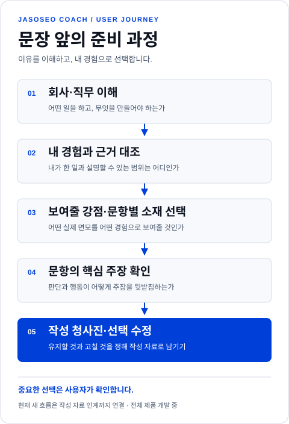
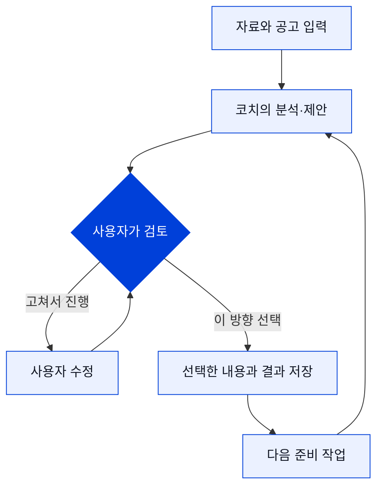

# 사용자 흐름

[← 프로젝트 소개](README.md) · [설계 의도](DESIGN_INTENT.md) · [시스템 설계](ARCHITECTURE.md) · [현재 상태](STATUS.md)

## 처음 온 사람도 다음 행동을 알 수 있도록

내부 실행 단계는 사용자 화면에서 업무의 의미로 표현합니다. 사용자는 단계 번호를 외우는 대신, 지금 무엇을 확인하고 다음에 어떤 선택을 해야 하는지 볼 수 있어야 합니다.

| 사용자에게 보이는 과정 | 사용자가 하는 일 | 코치가 돕는 일 |
|---|---|---|
| **공고 살펴보기** | 지원할 공고나 회사·직무 정보를 넣습니다. | 공고의 조건과 지원 준비에 필요한 정보를 정리합니다. |
| **회사·직무 이해하기** | 조사 범위와 결과를 확인합니다. | 실제 사업과 업무 산출물을 읽고, 필요한 본업 역량과 보조 강점을 나눕니다. |
| **내 경험 고르기** | 경험 파일을 가져오고 사용할 자료와 경험을 선택합니다. | 회사의 요구와 경험의 근거를 대조하고, 보여줄 강점을 제안합니다. |
| **문항별 요점 정하기** | 공식 질문과 문항별 핵심 주장을 검토하고 확정합니다. | 경험의 장면·판단·행동·결과를 어떤 논리로 전할지 정리합니다. |
| **작성 준비 자료 완성** | 구성 검토를 읽고 유지 또는 필요한 수정을 선택합니다. | 문항별 작성 청사진과 다음 작성 작업에 필요한 자료를 남깁니다. |
| **작성·검수** | 직접 작성하고 저장하며 결과를 검토합니다. | 기존 작성·검수 기능을 제공합니다. 새 설계에서 본문 생성으로 이어지는 자동 연결은 후속 범위입니다. |

## 과정마다 무엇을 얻어야 하나

### 공고를 볼 때: 지원할 일을 구체적으로 이해하기

공고의 단어를 자신의 경험에 끼워 맞추기 전에, 회사가 어떤 일을 하고 그 직무가 어떤 결과물을 만들어야 하는지 확인합니다. 조사 결과를 읽고 회사·직무 해석이 맞는지부터 봅니다. 이 단계가 있어야 ‘회사 맞춤’이 회사명만 바꾸는 작업에 머물지 않습니다.

### 경험을 고를 때: 쓸 수 있는 이야기와 빈 곳을 나누기

자료를 가져오고 사용할 경험을 선택합니다. 어떤 요구를 뒷받침하는지, 본인이 직접 한 일은 무엇인지, 추가 설명이 필요한 부분은 어디인지 봅니다. 증명할 수 없는 부분을 좋은 표현으로 덮는 대신 보완할 점으로 남기는 것이 목적입니다.

회사와 경험을 잇는 단위는 프로젝트 이름보다 실제 행동입니다. 어떤 일을 직접 수행했고 어떤 일에는 인접한 경험인지, 무엇은 아직 모르는지 나눠 봅니다. 개인 진술은 기본 자료로 사용하며 모든 경험에 문서 증빙을 강제하지 않습니다.

### 강점과 소재를 정할 때: 지원서 전체의 방향 선택하기

코치가 제안한 ‘보여줄 강점’을 사용자가 읽고 고칩니다. 이어서 공식 문항마다 어떤 경험을 배치할지 선택합니다. 같은 프로젝트도 다른 장면과 판단을 더하면 여러 문항에 쓸 수 있습니다. 가장 큰 수치나 성과를 먼저 쓰기보다 가장 잘 답하는 질문에 배치합니다. 강점은 성격 유형이 아니라 맡겨볼 업무를 뒷받침하는 인상이며, 강점 선택과 소재 선택은 별도 판단입니다.

### 문항을 설계할 때: 실제 판단이 보이게 만들기

경험의 제목만 고르는 것에서 한 단계 더 들어갑니다. 질문의 명시 요구를 먼저 확인하고, 실제로 어떤 상황에서 무엇을 관찰했으며 왜 그 방법을 선택했는지 봅니다. 선택과 결과의 설명 관계가 주장을 뒷받침하는지도 확인합니다. 질문에 대한 답과 경험의 근거가 맞닿는 핵심 주장을 전체 문항 묶음으로 확인합니다.

### 작성 준비를 마칠 때: 유지할 것과 고칠 것 정하기

주장이 확정되면 문항별 구성과 작성 자료를 검토합니다. 현재 계획을 유지할 수도 있고, 사용자가 고른 부분을 수정할 수도 있습니다. 검토 의견의 문제 진단과 처방을 나눠 보고, 사용자가 적용할 수정을 선택합니다. 이미 충분하면 유지할 수 있습니다. 생각을 바꿨을 때는 관련 판단을 다시 보고 확인해야 합니다. 이 결과를 다음 작성 작업에 넘길 수 있는 형태로 저장합니다.

### 글을 다룰 때: 초안의 탐색과 최종본의 조건 구분하기

설계상 초안은 충분히 쓴 뒤 의미를 보존하며 줄이는 방향입니다. 최종본은 확인한 글자 수 제한과 사실·기여 범위 등을 충족해야 합니다. 역할과 판단 이유는 충분히 설명하고, 독자가 행동에서 어떤 역량을 읽는지도 검토하려 합니다. 독립 첫 읽기는 목표 인상을 미리 알려주지 않고 본문에서 이해한 것을 먼저 받는 과정입니다. 현재 새 문항 설계에서 본문 생성과 전체 독자 검토로 이어지는 자동 연결은 남아 있습니다.

## 경험은 파일에서 시작할 수 있게

처음부터 모든 경험을 정해진 양식에 다시 쓰게 하기보다, 갖고 있는 자료를 가져와 확인하는 흐름을 제공합니다. 가져온 자료를 읽는 일과 그 안의 내용을 사실로 확정하는 일은 구분합니다. 개인 경험의 해석과 사용 범위는 사용자가 확인할 수 있게 둡니다.

## 선택할 때 멈추는 코치

보여줄 강점을 골랐다고 소재까지 자동 승인되지 않습니다. 소재를 골랐다고 핵심 주장이나 최종 문서가 확정되지도 않습니다. 각 선택이 의미 있는 지점에서 확인을 받습니다.

## 화면의 작은 안내

각 작업 화면에는 목적을 알려주는 짧은 TIP과 현재 단계 안내를 둡니다. 첫 사용자는 용어 설명을 찾기 전에 “왜 지금 이걸 하는지”를 이해할 수 있어야 합니다. 화면은 흰 작업 면, 짙은 글자, 선명한 코발트색 강조를 기준으로 구성합니다.

## 다시 접속했을 때

같은 브라우저의 체험 공간에서 저장한 지원서와 작업 결과를 다시 엽니다. 복원된 내용이 있다는 이유로 모델을 다시 호출하거나 승인을 대신하지 않습니다. 저장되지 않은 입력과 실제 저장된 내용도 구분해야 합니다.

현재 체험은 브라우저별 지원서 **2건**입니다. 계정 기반 서비스가 아니므로 쿠키 삭제·기기 변경 시 이전 공간을 되찾는 흐름은 제공하지 않습니다.
