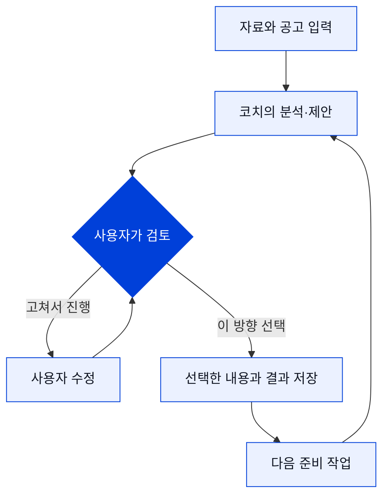

# 사용자 흐름

[← 프로젝트 소개](README.md) · [시스템 설계](ARCHITECTURE.md) · [현재 상태](STATUS.md)

## 처음 온 사람도 다음 행동을 알 수 있도록

내부 실행 단계는 사용자 화면에서 업무의 의미로 표현합니다. 사용자는 단계 번호를 외우는 대신, 지금 무엇을 확인하고 다음에 어떤 선택을 해야 하는지 볼 수 있어야 합니다.

| 사용자에게 보이는 과정 | 사용자가 하는 일 | 코치가 돕는 일 |
|---|---|---|
| **공고 살펴보기** | 지원할 공고나 회사·직무 정보를 넣습니다. | 공고의 조건과 지원 준비에 필요한 정보를 정리합니다. |
| **회사·직무 이해하기** | 조사 범위와 결과를 확인합니다. | 실제 사업, 업무, 산출물과 요구 역량을 연결해 설명합니다. |
| **내 경험 고르기** | 경험 파일을 가져오고 사용할 자료와 경험을 선택합니다. | 회사의 요구와 경험의 근거를 대조하고, 보여줄 강점을 제안합니다. |
| **문항별 요점 정하기** | 공식 질문과 문항별 핵심 주장을 검토하고 확정합니다. | 경험의 장면·판단·행동·결과를 어떤 논리로 전할지 정리합니다. |
| **작성 준비 자료 완성** | 구성 검토를 읽고 유지 또는 필요한 수정을 선택합니다. | 문항별 작성 청사진과 다음 작성 작업에 필요한 자료를 남깁니다. |
| **작성·검수** | 직접 작성하고 저장하며 결과를 검토합니다. | 기존 작성·검수 기능을 제공합니다. 새 설계에서 본문 생성으로 이어지는 자동 연결은 후속 범위입니다. |

## 경험은 파일에서 시작할 수 있게

처음부터 모든 경험을 정해진 양식에 다시 쓰게 하기보다, 갖고 있는 자료를 가져와 확인하는 흐름을 제공합니다. 가져온 자료를 읽는 일과 그 안의 내용을 사실로 확정하는 일은 구분합니다. 개인 경험의 해석과 사용 범위는 사용자가 확인할 수 있게 둡니다.

## 선택할 때 멈추는 코치

보여줄 강점을 골랐다고 소재까지 자동 승인되지 않습니다. 소재를 골랐다고 핵심 주장이나 최종 문서가 확정되지도 않습니다. 각 선택이 의미 있는 지점에서 확인을 받습니다.

## 화면의 작은 안내

각 작업 화면에는 목적을 알려주는 짧은 TIP과 현재 단계 안내를 둡니다. 첫 사용자는 용어 설명을 찾기 전에 “왜 지금 이걸 하는지”를 이해할 수 있어야 합니다. 화면은 흰 작업 면, 짙은 글자, 선명한 코발트색 강조를 기준으로 구성합니다.

## 다시 접속했을 때

같은 브라우저의 체험 공간에서 저장한 지원서와 작업 결과를 다시 엽니다. 복원된 내용이 있다는 이유로 모델을 다시 호출하거나 승인을 대신하지 않습니다. 저장되지 않은 입력과 실제 저장된 내용도 구분해야 합니다.

현재 체험은 브라우저별 지원서 **2건**입니다. 계정 기반 서비스가 아니므로 쿠키 삭제·기기 변경 시 이전 공간을 되찾는 흐름은 제공하지 않습니다.
